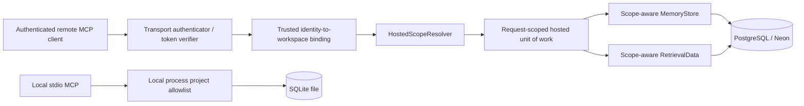

# Hosted PostgreSQL Runtime Integration Audit

**Audit date:** 2026-10-16
**Scope:** Read-only repository inspection and implementation planning. This report does not enable hosted runtime behavior or establish production readiness.

## 1. Executive summary

Celestin has useful PostgreSQL foundations: a versioned migration runner, a workspace-aware `MemoryStore` adapter, and request-transaction authorization components. They are not selected by the production MCP server. `orbit.mcp_server.server` creates the default SQLite persistence and retrieval services, and `main()` starts FastMCP over stdio. The current tools accept a project string and have a local process-level allowlist; stdio does not authenticate individual clients.

Therefore, the repository does **not** yet provide a hosted PostgreSQL MCP runtime, PostgreSQL-backed retrieval, per-user MCP authentication, or a request path that atomically authorizes and performs data operations. A project-pinned Neon MCP URL in Codex configuration is for Codex's connection to Neon tools; it does not configure Celestin's own database connection.

The least risky path is additive: first define a request-scoped application/runtime composition boundary that accepts a verified principal and resolved workspace/project scope; then make PostgreSQL persistence and retrieval use that same scope and transaction; then expose it through a reviewed authenticated transport while retaining the current stdio/SQLite default. Explicit migrations remain separate from application startup.

## 2. Verified repository baseline

- Worktree: `E:\Anton.code\Events\Devday - OpenAI\main\devday---PetCompaninon`.
- Branch: `codex/granular-commit-watcher`.
- HEAD: `1200d2653ba53c2bf246e6f9b09b72ba6529b87c` — `feat: add hosted PostgreSQL foundations and integration safeguards`.
- HEAD matches the requested checkpoint. `git status --short --branch` showed a clean working tree and branch `ahead 32` of its configured upstream. No staged, unstaged, or untracked work was present at inspection.
- The root `AGENTS.md` applies. No nested `AGENTS.md` was found. Its repository workflow also points to `RULES.md`, `docs/loop-engineering-core.md`, `docs/celestin-loop-rules.md`, and `docs/loop-engineering.md`; these were consulted along with the PostgreSQL migration, integration-test, identity-scope, and evidence-linked-memory documentation.
- The requested report did not exist before this audit.

The only repository change made for this task is this report. As required by the task-specific scope, no source, test, schema, migration, environment, or MCP configuration was changed. No tests were run. No database, Neon service, or SQL command was accessed. The repository's Orbit memory skill was consulted using the documented canonical project ID `celestin`; retrieval returned `ACCESS_DENIED`, so this report is based on repository evidence only and that read was not retried.

## 3. Actual runtime architecture

### 3.1 Entry points and startup

`pyproject.toml` defines `celestin`, `orbit`, and `memory-bridge` as aliases for `orbit.mcp_server.server:main` (lines 13–20). It also defines `celestin-migrate` for `orbit.postgres.migrate_cli:main` (line 17). Python is declared `>=3.10`; `psycopg[binary]` is an optional `postgres` extra, not a required dependency (lines 10–26).

`src/orbit/mcp_server/server.py` constructs `FastMCP("Celestin")` (line 27), creates `PersistenceServices()` and `RetrievalServices()` globals (lines 87–89), registers `ingest_chat_message`, `save_decision`, `search_chat_history`, `retrieve_context`, and `ping` (lines 172–255), and runs only `mcp.run(transport="stdio")` from `main()` (lines 258–260). There is no HTTP listener or remote transport in this entry point.

### 3.2 Current SQLite persistence flow

The write path is:

```text
MCP tool handler
  -> _AuthorizedPersistenceServices in server.py
  -> PersistenceServices in persistence_services.py
  -> SQLiteMemoryStore in storage/sqlite.py
  -> ChatMessageRepository / DecisionRepository
  -> orbit.database.engine.connect()
  -> SQLite database file
```

The server validates tool arguments and calls the local project policy before invoking the persistence backend (`server.py:100–114`, `172–219`). `PersistenceServices` defaults to `SQLiteMemoryStore` (`persistence_services.py:12–26`). That adapter opens SQLite for each operation and delegates message and decision storage to the existing repositories (`storage/sqlite.py`; `repositories/messages.py`; `repositories/decisions.py`). The repositories validate fields, commit writes, and keep source-message references project-scoped. Semantic indexing, when enabled, occurs after the primary SQLite write and is best-effort; failures are logged and can be repaired by `celestin-index sync` (`storage/sqlite.py`; `semantic/config.py`). Thus the primary write is not rolled back if optional indexing fails.

`engine.py:25–31` selects `CELESTIN_DB_PATH`, then legacy `MEMORY_BRIDGE_DB_PATH`, then `data/memory_bridge.db`. The module-level `DB_PATH` is resolved at import time. `connect()` creates parent directories and applies ordered SQLite migrations on connection (`engine.py:158–175`, `195–213`). SQLite uses `PRAGMA user_version`; the current schema has integer IDs, project-string ownership, and `project_memory.source_message_id` referencing a message with `ON DELETE SET NULL` (`engine.py:35–64`). FTS5 tables/triggers are also initialized by the SQLite migration (`engine.py:65–147`).

The engine's migration wrapper deserves a focused follow-up review: it calls `BEGIN IMMEDIATE`, then `sqlite3.Connection.executescript()`, whose implicit-commit behavior is explicitly noted in `engine.py:183–192`. That means DDL and the `user_version` update are not one atomic unit in the way the surrounding shape may suggest. This audit did not reproduce a failure; acceptance tests should verify how a mid-script error leaves the SQLite schema/version and whether recovery is safe before changing it.

### 3.3 Current PostgreSQL persistence foundation

`MemoryStore` in `src/orbit/storage/protocol.py` is a narrow persistence port for inserting a message, saving a decision, and updating decision status. It uses database-neutral stored records and string public IDs. `PostgresMemoryStore` in `src/orbit/storage/postgres.py` implements this port, accepts a configured workspace UUID, maps the public project key to `celestin_projects.legacy_project_key` inside that workspace, and scopes message/decision writes with workspace and project IDs (`postgres.py:43–76`, `78–216`). It performs a source-message ownership lookup before a decision write and relies on hosted-schema composite foreign keys as a relational backstop.

The PostgreSQL adapter is injectable and does not connect at construction; its psycopg import is lazy. Each adapter operation obtains a connection from its supplied factory and runs in a connection context (`postgres.py:46–76`). There is no application-level PostgreSQL pool, backend selector, or MCP-server construction call to `PostgresMemoryStore`. The current adapter binds one workspace at construction and accepts a caller-facing project string; for hosted multi-user runtime, it must be composed with the trusted resolved scope rather than used as an authorization mechanism by itself.

### 3.4 Retrieval and ranking

`RetrievalData` in `src/orbit/retrieval/data.py` is a database-neutral data port for message/decision searches and authoritative record reloads. `SQLiteRetrievalData` in `src/orbit/retrieval/sqlite_data.py` owns FTS5 SQL, SQLite row conversion, SQLite IDs, and project-scoped reloads. `RetrievalService` contains shared strategy orchestration, ranking/fusion, decision filtering, and context assembly (`retrieval/service.py`). It can accept the data port, but when given the current connection it selects `SQLiteRetrievalData` (`service.py:162–237`).

The MCP-facing `RetrievalServices` in `src/orbit/mcp_server/retrieval_services.py` opens a SQLite connection per call, constructs `RetrievalService` with that connection, and translates results into the stable response dictionaries (lines 60–90 and subsequent context-result mapping). The server's global retrieval backend is this SQLite-facing wrapper (`server.py:88–89`). No PostgreSQL `RetrievalData` adapter exists.

Retrieval also has optional components outside the primary message database:

- Semantic embeddings are opt-in. Vector data is kept in a separate SQLite vector-index file; indexing after writes is best-effort and can be synchronized later (`semantic/config.py`).
- PageIndex document/section state is maintained separately, and model-assisted outline navigation is opt-in (`pageindex/config.py`).
- Ranking, reciprocal-rank fusion, filtering, and context budgeting are shared application logic, but indexed candidate discovery and document/vector stores have backend-specific state.

For PostgreSQL, `tsvector`/`tsquery` plus `ts_rank` or `ts_rank_cd` are possible keyword-search mechanisms, but PostgreSQL ranking and tokenization are not numerically equivalent to SQLite FTS5 `MATCH`/`bm25()`. Compatibility should be defined by project isolation, relevance-set behavior, stable ordering/tie-breaks, filtering, and response shape—not equality of score numbers.

### 3.5 Tenant context, authentication, and authorization

The present MCP server calls `_stdio_principal()`, which returns `None`, and passes the tool's `project` argument to a fail-closed process-level `ProjectAccessPolicy` (`server.py:81–98`; `authorization.py:1–6`, `73–128`). This is local allowlist authorization. It is not a per-client identity and the comments explicitly say it does not protect against untrusted processes running as the same local user. The public project string is a selector, not proof of identity.

Hosted foundations exist separately:

- `VerifiedPrincipal`, `WorkspaceBinding`, `ProjectAccessRecord`, `ResolvedProjectScope`, and `HostedScopeResolver` live in `src/orbit/mcp_server/hosted_scope.py`. The resolver validates an identity already treated as trusted, binds a workspace server-side, checks identity/membership/service state, project lifecycle, an explicit grant, and read/write capability, and supports a source-message lookup inside scope.
- `PostgresHostedAuthorizationSessionFactory` and its session implementation live in `src/orbit/postgres/authorization.py`. The request transaction locks and checks authorization rows and provides a place to execute an authorized operation in the same transaction.
- The hosted scope is not produced by token/session validation in the repository and neither resolver nor factory is called from the actual MCP server. The docs explicitly describe the components as unconnected (`docs/hosted-identity-scope.md:5–10`, `71–83`). No OIDC/JWT/API-key authenticator or trusted remote transport identity mapping was found in this audit.

The hosted schema provides database-level tenant relationships: workspace/project IDs, composite foreign keys for membership and source references, and uniqueness constraints. These constraints prevent inconsistent relational references; they do not authenticate callers or replace application authorization. The schema also has a partial index for active owners, but a normal index does not enforce that every workspace always has one (`0001_hosted_baseline.sql:37–40`).

### 3.6 Migrations, connections, errors, and observability

PostgreSQL migrations are separate, explicit, and ordered. `src/orbit/postgres/migrations/runner.py` loads contiguous numbered migration resources, computes SHA-256 checksums, takes a session advisory lock, refuses an untracked/non-fresh schema, validates existing ledger names/checksums, and applies each migration plus ledger row in a transaction (`runner.py:55–86`, `144–251`). The explicit `celestin-migrate` CLI reads `CELESTIN_POSTGRES_DSN` by default (`migrate_cli.py`); ordinary SQLite connect/server startup does not invoke this runner. The two packaged migrations define the hosted baseline and fail-closed user status (`migrations/0001_hosted_baseline.sql`, `0002_user_status.sql`).

There is no configured PostgreSQL pool in the MCP application. The prototype persistence adapter and authorization factory use connection factories and short connection contexts; production limits, pool sizing, acquisition timeout, shutdown handling, cancellation, and retry policy remain unimplemented. No retry layer was observed for hosted writes. Existing server handlers log operation names and exception classes rather than message content/query text (`server.py:151–169`) and map errors to stable safe categories for the existing SQLite path. A PostgreSQL runtime needs explicit driver-error translation because the current handlers directly catch SQLite/database exceptions, not a documented backend-neutral hosted error family.

The test layout includes SQLite and MCP tests, scripted PostgreSQL protocol/authorization/migration tests, and an opt-in real PostgreSQL suite under `tests/postgres/test_live_authorization.py`. `tests/postgres/conftest.py` skips marked live tests by default and only proceeds with explicit opt-in plus target configuration; its fixture verifies the target and applies migrations. Scripted tests establish query intent and transaction behavior against fakes, not live PostgreSQL semantics. No test was run for this audit, so no pass count is claimed.

## 4. Current-versus-target integration matrix

| Capability | Current implementation | Runtime wired? | Evidence | Missing work |
|---|---|---:|---|---|
| SQLite message/decision writes | `SQLiteMemoryStore` delegates to SQLite repositories; per-call connection; repository commit semantics. | Yes | `server.py:87–89`; `persistence_services.py:20–46`; `storage/sqlite.py`; `repositories/messages.py`, `decisions.py` | Preserve behavior while adding explicit backend composition and shared transaction/error contracts. |
| SQLite reads and search | `RetrievalServices` opens SQLite; `SQLiteRetrievalData` owns FTS5 and authoritative reloads; shared ranking/context code. | Yes | `server.py:89`; `retrieval_services.py:60–90`; `retrieval/sqlite_data.py`; `retrieval/service.py` | Keep SQLite as default and run parity/regression tests through the server seam. |
| PostgreSQL message/decision writes | `PostgresMemoryStore` implements the persistence port and binds a configured workspace UUID. | No | `storage/postgres.py:43–76`; repository-wide callers only in tests/docs; server constructs default `PersistenceServices()` | Add trusted scope-aware composition, shared unit-of-work/transaction design, driver error mapping, and runtime tests. |
| PostgreSQL retrieval and ranking | Shared `RetrievalService` plus a SQLite retrieval-data adapter; no PostgreSQL data adapter. | No | `retrieval/data.py`; `retrieval/sqlite_data.py`; no `PostgresRetrievalData` found | Implement scoped Postgres search/load methods and choose PostgreSQL text-search configuration; compare behavior by invariant, not BM25 equality. |
| Project/workspace scope | Local tools take a public project string; PG prototype resolves it within a constructor-bound workspace. Hosted resolver produces a UUID scope. | Partial foundations only | `server.py:103–125`; `storage/postgres.py:203–216`; `hosted_scope.py` | Bind verified principal/workspace at trusted transport boundary and pass `ResolvedProjectScope` through every operation, cache, search, reload, and source lookup. |
| Authentication/session validation | No active identity provider or token/session validator in MCP path. `VerifiedPrincipal` is a type/seam, not an authenticator. | No for hosted runtime | `hosted_scope.py`; `hosted-identity-scope.md:12–24`, `85–97` | Select issuer/client model, validate credentials and lifecycle, map identity to a trusted workspace, handle revocation. |
| Tenant authorization | Local process allowlist runs before current tool backend calls. Hosted resolver/session are separate and not called by tools. | Local only | `authorization.py`; `server.py:81–129`; `hosted-identity-scope.md:71–83` | Integrate authorization with each hosted request and data operation in one transaction; do not trust project arguments. |
| Tenant relational integrity | Hosted SQL defines composite workspace/project and source-message relationships. | Schema only | `0001_hosted_baseline.sql:41–71`, `117–163` | Validate all hosted reads/writes use those keys; database constraints remain defense in depth, not identity authorization. |
| Schema migrations | SQLite auto-applies `user_version` migrations on `connect`; PG runner is an explicit CLI with ledger/checksum/lock. | SQLite yes; PG operator-only | `database/engine.py:195–213`; `pyproject.toml:17`; `postgres/migrations/runner.py`; `postgres-migrations.md` | Deployment orchestration, compatibility/backfill plan, observability and tested rollback/recovery; do not auto-migrate on MCP requests. |
| Connection pooling/lifecycle | SQLite opens local connections per service operation. PG prototypes use connection factory/context per operation/request. | No hosted pool | `storage/sqlite.py`; `retrieval_services.py:66–68`; `storage/postgres.py:46–50`; `postgres/authorization.py` | Decide pool owner, max size, idle/acquire timeouts, shutdown, cancellation and overload behavior. |
| MCP transport/configuration | Installed commands launch FastMCP over stdio. `.codex/config.toml` pins a Neon MCP URL for Codex. | Stdio only for Celestin | `server.py:258–260`; `.codex/config.toml` | Pick a supported authenticated remote MCP transport or separate API; test context propagation and tool compatibility. Codex's Neon MCP config is not Celestin DB config. |
| Hosted DB configuration | `CELESTIN_POSTGRES_DSN` belongs to explicit migration CLI; `PostgresMemoryStore.from_dsn()` exists but is not selected by server. | No hosted runtime selector | `migrate_cli.py`; `storage/postgres.py:61–76`; `postgres-migrations.md` | Add strict backend selector and secret-manager/runtime config validation without changing local default. |
| Error handling/observability | Safe category mapping and redacted logging on MCP/SQLite path; PG migration errors sanitized by CLI; PG prototype lacks integrated MCP mapping/metrics. | Partial | `server.py:132–169`; `migrate_cli.py`; PG scripted tests | Normalize expected DB errors, keep SQL/DSN/content out of outputs, add structured metrics and correlation IDs without sensitive payloads. |
| Optional semantic/PageIndex | Separate local vector/document stores; opt-in or availability-based; semantic indexing is best-effort after SQLite writes. | SQLite only | `semantic/config.py`; `pageindex/config.py`; `storage/sqlite.py` | Decide whether/how indexes become tenant-scoped and rebuildable for hosted mode; no silent fallback that returns cross-tenant/stale candidates. |

## 5. Confirmed gaps and ranked risks

### Critical before any hosted exposure

1. **No authenticated runtime path.** The current MCP caller is stdio with `_stdio_principal() is None`; hosted principal types are not populated by a verifier. Exposing a hosted listener while accepting tool-supplied project names would not meet user identity/project authorization requirements.
2. **Hosted authorization and data work are not integrated.** The resolver/factory can express authorization in a transaction, but production tools call local allowlist wrappers and then an independently selected SQLite backend. The hosted storage prototype opens its own connection per method and takes a workspace UUID at construction. A future hosted operation must not authorize in one transaction and then execute against a separate unscoped store/connection.
3. **No PostgreSQL retrieval adapter.** Search, authoritative record reload, and context assembly currently start from SQLite. Turning on PostgreSQL persistence alone would make stored data unavailable to existing search/context tools and would leave scope guarantees incomplete.

### High priority before real multi-user service

4. **No explicit application backend selection or lifecycle owner.** The server globals hard-code SQLite service construction. There is no PostgreSQL pool, startup/shutdown hook for a pool, connection limit, or runtime health/readiness behavior.
5. **ID and timestamp compatibility needs an explicit contract.** Both schemas use numeric message/decision IDs today, but SQLite uses row IDs and PostgreSQL uses `BIGINT GENERATED ... AS IDENTITY`; the API represents IDs as strings. SQLite decisions store `updated_at` only, whereas hosted SQL stores both `created_at` and `updated_at`; parity needs an agreed rule for existing data/backfill and update semantics. Do not promise stable cross-database IDs for imported SQLite data without a collision/backfill plan.
6. **Search ranking is not portable by numeric value.** SQLite FTS5/BM25 cannot be replaced by PostgreSQL full-text ranking while expecting identical scores. Define response compatibility and deterministic ordering separately from score equality.
7. **Optional indexes are separate persistence surfaces.** Semantic vectors and PageIndex state have local SQLite paths, caches, and best-effort/deferred synchronization. They need explicit tenant-aware storage keys and rebuild/reconciliation behavior before use with hosted records.
8. **Operational and migration readiness remains incomplete.** The PG migration runner is explicit and guarded, which is appropriate; hosted deployment still needs tested provisioning, backups/restore, migration release order, bounded connections, secret rotation, telemetry, and recovery procedures. The user-status migration defaults users to suspended, so trusted administrative provisioning/activation is required.

### Confirmed policy gap

The schema's active-owner partial index is an index aid, not a prohibition on removing/demoting the final active owner. Owner-changing transactions need an application/database locking rule and concurrency tests. This audit did not validate the behavior against a live PostgreSQL server.

### Questions not settled by repository evidence

- Which hosted MCP transport/client combination is the initial supported product surface, and what credential type will it validate?
- Is the hosted service single-workspace per credential or multi-workspace with server-side workspace selection?
- Should one hosted operation use a short-lived dedicated connection or a bounded pool? What is the hosting platform's concurrency/timeout profile?
- How should existing SQLite databases be imported, including ID collisions, timestamp normalization, duplicate project keys across workspaces, and resumable idempotency?
- Are semantic search, PageIndex, document ingestion, and rerankers in the first hosted release or explicitly deferred?
- What are retention, archive/purge authorization, backup, restore, and data residency requirements?
- What is the owner lifecycle policy and how is the last-active-owner invariant enforced transactionally?

## 6. Proposed target architecture

The following is a proposal, not current behavior:



Keep separate compositions: existing `celestin`/`orbit` stdio clients retain the SQLite default and local process allowlist. A hosted composition is enabled only through an explicit, validated backend/transport configuration. The remote boundary validates credentials, derives a `VerifiedPrincipal` from trusted claims, obtains workspace binding from server-side configuration/identity data, and resolves a project key to immutable `ResolvedProjectScope`. The MCP `project` remains a selector only.

The hosted request then opens one bounded request transaction/unit-of-work. Authorization row locks/checks, source-message checks, scoped persistence writes, and retrieval reads execute through that request context. Data adapters accept `ResolvedProjectScope` or narrower typed UUID projection—not a bare project string—and bind `workspace_id` and `project_id` in every query. Caches, semantic candidate reloads, and context assembly use the same scope. On success the transaction commits before the tool result is returned; on failure it rolls back and maps driver errors to stable, redacted error categories.

Reuse `MemoryStore` and `RetrievalData` as local ports where that preserves their current contracts. Avoid making a broad generic framework: a small hosted request composition/uow may coordinate authorization plus store/search data on one connection, while the existing SQLite adapters remain unchanged. If the ports cannot express request scope and shared transaction ownership cleanly, add a hosted-specific scoped port rather than passing public project strings into PostgreSQL methods.

For search, start with PostgreSQL built-in full-text search (`to_tsvector`/`websearch_to_tsquery` or a deliberately chosen query form and text-search configuration) and a database-backed index maintained transactionally. Return backend-neutral candidates with stable IDs, text, source, timestamp, and a documented relevance score. Keep ranking/fusion/context policy shared; use deterministic tie-breaking. Test fixtures for both adapters should assert scope, candidate inclusion/exclusion, status policy, stable response fields, and ordering where defined—not identical score values.

Semantic/vector and PageIndex integration should be a deliberate later decision. The safe first hosted release may ship keyword retrieval only while preserving the SQLite optional features locally. If hosted semantic retrieval is in scope, its index must be tenant-scoped, rebuildable from authoritative rows, and candidates must be reloaded under the authorized scope before output. Do not allow a shared cache or vector result to bypass project authorization.

## 7. Dependency-ordered implementation roadmap

### Phase 1 — Runtime composition and configuration contract

- **Likely files:** `src/orbit/mcp_server/server.py`, `persistence_services.py`, `retrieval_services.py`; a small runtime/configuration module; `src/orbit/storage/protocol.py`; tests in `tests/test_mcp_tools.py`, persistence tests, and a new runtime composition test module; README and migration/runtime docs.
- **Work:** Define explicit modes and fail-closed validation. Preserve SQLite as default and preserve aliases/path variables. Make backend/service construction injectable at startup. Keep psycopg optional and ensure importing/running SQLite mode does not require it. Do not enable hosted mode until auth and scoped operations are composed.
- **Acceptance:** Default launch still uses SQLite and existing `CELESTIN_DB_PATH`/legacy precedence. Invalid or partial hosted config fails before listening. A fake factory proves selected services are injected; server tool names/schemas/outputs remain unchanged.
- **Risks/rollback:** Keep new selector opt-in; revert selector wiring independently if compatibility tests fail.

### Phase 2 — Scope-aware PostgreSQL persistence and transaction ownership

- **Likely files:** `src/orbit/storage/postgres.py`, `protocol.py` or a hosted-specific scoped protocol, `src/orbit/postgres/authorization.py`, `hosted_scope.py`, `persistence_services.py`; tests under `tests/storage` and `tests/postgres`.
- **Work:** Replace constructor-only workspace trust with request-derived scope. Ensure identity/grant locks and writes share one connection/transaction. Preserve source-message project/workspace checking and error redaction. Define connection factory/pool ownership and close behavior.
- **Acceptance:** Same-scope write succeeds; unknown/suspended/revoked/missing-grant and altered project scope deny before data SQL; cross-project source references fail; transaction rollback/commit tests exercise the same session; IDs and UTC timestamp DTOs remain compatible.
- **Risks/rollback:** No endpoint exposure yet. Integration can remain behind an internal factory until live tests pass.

### Phase 3 — PostgreSQL retrieval adapter

- **Likely files:** new `src/orbit/retrieval/postgres_data.py`; `retrieval/data.py`, `retrieval/service.py`, `mcp_server/retrieval_services.py`; migrations for search indexes only if justified; retrieval/PostgreSQL tests.
- **Work:** Implement tenant-filtered full-text search and authoritative loads using scope. Keep common filtering, fusion, deduplication, ranking orchestration, and context budget behavior shared. Specify score semantics and deterministic tie breaks. Defer or separately scope embeddings/PageIndex.
- **Acceptance:** Contract tests cover same-project results, no cross-tenant candidates/reloads, approved/deprecated policy, stable public response shape, empty results, and context budget; SQLite retrieval regression suite remains green.
- **Risks/rollback:** Different tokenizer and ranking results. Keep PostgreSQL search selectable only in hosted composition; no change to SQLite FTS5.

### Phase 4 — Trusted authentication and authorization composition

- **Likely files:** new authenticator/transport modules; `hosted_scope.py`, `postgres/authorization.py`, `server.py`; security docs and hosted request tests.
- **Work:** Select and implement a supported authentication protocol/provider; validate issuer, audience, signature/expiry, subject, principal kind, and revocation strategy; derive workspace binding server-side; ensure no MCP argument can construct trusted identity or scope. Decide human and service credential lifecycle.
- **Acceptance:** Missing, malformed, expired, wrong-audience, unknown, suspended, and revoked identities deny; project selector tampering cannot cross workspace; all four data tools authorize before data access; safe errors disclose no cross-tenant existence.
- **Risks/rollback:** Provider outages and revocation delay. No remote listener until these tests pass and provider decisions are reviewed.

### Phase 5 — Migration and compatibility/data-import plan

- **Likely files:** `src/orbit/postgres/migrations/` additive numbered migrations; runner/CLI tests only if defects arise; `docs/postgres-migrations.md`; dedicated import tool/module and tests only after import policy approval.
- **Work:** Keep migrations explicit, serialized, immutable and checksum-verified. Define expand/contract releases, rollback/forward-fix policy, backups, and pre/postflight. Separately design a resumable idempotent SQLite import with public-ID mapping, timestamps, and workspace/project mapping.
- **Acceptance:** Fresh database migration, repeated no-op, checksum mismatch refusal, partial migration recovery and backup restore are verified on disposable PostgreSQL. Import proves counts/provenance and deterministic retry without overwriting production data.
- **Risks/rollback:** Schema downgrade may be unsafe; use forward fixes and restore procedures. Never point test tooling to production.

### Phase 6 — End-to-end runtime and client validation

- **Likely files:** server/composition modules, MCP transport integration tests, `tests/postgres/test_live_authorization.py` and new live persistence/retrieval coverage, client setup docs.
- **Work:** Connect authenticated MCP request context to scoped data unit-of-work. Verify all four tools through the real transport using synthetic data on an approved disposable target. Confirm local SQLite tools and aliases still work.
- **Acceptance:** MCP initialization and tool discovery; authorized synthetic write/read round-trip; denial and scope isolation; cleanup and bounded concurrency; no live test target reuse after migration failure.
- **Risks/rollback:** Transport SDK may not propagate trusted auth context as expected. Keep remote mode disabled until client interoperability is demonstrated.

### Phase 7 — Hosted operations and production readiness

- **Likely files:** deployment/runtime configuration, secret integration, health/metrics modules, operational docs, monitoring and load tests; migration/backup runbooks.
- **Work:** Configure secret-manager sourced credentials, bounded pool, TLS, timeout/cancellation policy, metrics/traces, backups/restore, retention/purge, incident and credential-rotation procedures, resource limits, deployment and migration ordering.
- **Acceptance:** Restore drill, secret rotation, pool saturation and DB outage behavior tested; no credential leakage; load/cost/SLO and data retention reviewed; owner/admin lifecycle policy and active-owner guarantee implemented/tested.
- **Risks/rollback:** Operational complexity and data-loss consequences. Production launch requires explicit product/security/operations approval.

## 8. Verification matrix

| Requirement | Existing evidence | Required test/evidence | Live PostgreSQL needed? | External setup? | Success condition |
|---|---|---|---:|---:|---|
| SQLite startup and persistence compatibility | Existing engine/repository/MCP tests; environment/path contract in `engine.py` | Full SQLite, MCP stdio protocol, alias and path-precedence regression suite | No | No | Existing local tools, IDs, errors, and database behavior unchanged. |
| Backend selection | No runtime selector; server globals currently hard-code defaults | Unit tests for default SQLite, explicit PG selection, incomplete/invalid config | No for selection logic | Secret/config source needed for integration | SQLite remains default; hosted mode cannot partially start. |
| PG migrations | Explicit runner has fake/scripted tests; live fixture opt-in | Fresh DB apply, checksum/no-op, failure atomicity, concurrent migration runner | Yes | Approved disposable DB + least-privilege role | Ledger and schema match release; no adoption of untracked objects. |
| PG persistence | Fake `PostgresMemoryStore` contract tests exist | Commit/rollback, insert/upsert/status, timestamps/ID mapping, source-ref integrity | Yes for driver/DDL semantics | Approved disposable DB | Runtime store uses one authorized scope and returns stable DTOs. |
| Hosted auth context | Resolver and session have scripted tests; no credential verifier | Provider token validation, identity binding, expired/revoked/unknown cases | Usually yes for integrated DB state | Auth provider configuration/keys | Only verified claims produce trusted principal; caller cannot choose identity/workspace. |
| Tenant/project isolation | Composite schema constraints and scoped SQL exist in foundations | Cross-workspace/project reads/writes, altered project key, cache/index isolation | Yes for real constraints/concurrency | Disposable DB and synthetic fixtures | No data or existence signal escapes permitted scope. |
| Source provenance | SQLite repo checks same-project source; PG adapter has scoped lookup and composite FK | Valid/invalid/cross-project source, delete restriction, provenance retention | Yes for FK/locking | None beyond disposable DB | Source reference is validated in same transaction and cannot cross tenant. |
| PostgreSQL retrieval | No adapter today | Candidate query, authoritative reload, status filtering, deterministic tie-break, empty/error cases | Yes for dialect/search indexes | Disposable DB | Query results obey scope and response contract; no score parity claim. |
| Semantic/PageIndex | Local opt-in implementations and best-effort indexing | Hosted rebuild/reconciliation, scope-keyed cache, stale candidate reload, failure behavior | Maybe, depending selected hosted stores | Embedding/model service if enabled | Index failures do not corrupt primary records or expose cross-project results. |
| Error handling/observability | SQLite-safe tool errors and migration sanitization | Psycopg connection/query/commit/timeout failure, redaction, metrics | Some tests can fake; integration recommended | None for unit tests | Public error categories stable and secrets/content/SQL are not returned. |
| Pool/lifecycle | No pool, per-operation factories in PG prototypes | Bounded concurrency, exhaustion, shutdown, cancellation, leaks | Prefer live load/integration test | Hosted runtime profile | Connections close/release on success/failure and resource bounds are enforced. |
| Revocation/concurrency | Lock order documented; scripted tests; opt-in live auth tests exist | Separate-connection grant revoke/suspension versus in-flight operations | Yes | Fresh disposable target | Actual serialization behavior matches documented “in-flight transaction may finish” policy. |
| Last active owner | Partial index only | Concurrent demotion/removal/transfer tests under chosen locking/isolation | Yes | None beyond disposable DB | No committed transaction can leave workspace without active owner. |
| Neon configuration vs app DB | `.codex/config.toml` has a project-pinned Neon MCP URL; application code uses explicit PG factory/migration env | Runtime config review plus a harmless approved app health check once wired | Yes to prove app DB access | Neon project/secrets and authorization | Only claim Celestin uses Neon after its own runtime connects and data operation succeeds. |

## 9. Decisions requiring owner approval

1. Initial hosted client/transport and authentication provider; supported credential types and token audience/issuer policy.
2. Workspace selection semantics: one workspace per credential or multiple workspaces resolved server-side.
3. Whether the first hosted release includes only keyword retrieval or also vector embeddings, PageIndex documents, and reranking.
4. Whether score values are considered externally stable; recommended answer is to keep only relative ordering/relevance semantics stable across backends.
5. SQLite import scope, ID mapping, duplicate-key rules, timestamp policy, and whether import must preserve all current local data.
6. Connection pool owner, concurrency limits, timeouts, cancellation, retry/idempotency rules, and overload response.
7. Revocation semantics: current row locks imply a protected in-flight operation can complete before a concurrent revocation commits; decide whether that is acceptable and what credential revocation delay is acceptable.
8. Workspace owner lifecycle, archive/retention/purge behavior, backup retention, restore objectives, and data residency.
9. Migration deployment ownership and approval gate; migrations should remain explicit and should not run on each MCP tool request.
10. Whether Codex's project-pinned Neon MCP configuration is intended only for engineering operations (as it currently is) or whether a separate Celestin application credential/configuration will be provisioned.

## 10. Audit limits and next step

**Verified by source inspection:** current stdio tool registration, SQLite defaults and path precedence, persistence/retrieval adapters, the unselected PostgreSQL persistence implementation, hosted scope/session foundations, explicit migration mechanics, schema relationships, and the separation between Codex Neon MCP configuration and Celestin database configuration.

**Not verified:** test pass counts in this checkout; actual MCP client invocation during this audit; any Neon MCP call; any PostgreSQL connection, migration, live authorization behavior, connection-pool behavior, hosted authentication, remote transport, PostgreSQL retrieval, data import, backup/restore, or production readiness. No live database or Neon resource was contacted, and no test command was run.

**Recommended first implementation task:** add a minimal, testable runtime composition seam that preserves the current SQLite default and public tool contracts, but accepts an explicitly constructed hosted request context/unit-of-work only when a trusted principal and a `ResolvedProjectScope` are supplied. Do not enable a hosted transport in that first task. Acceptance should show SQLite behavior unchanged and prove that PostgreSQL cannot be selected from a caller-provided project string or incomplete environment configuration.
