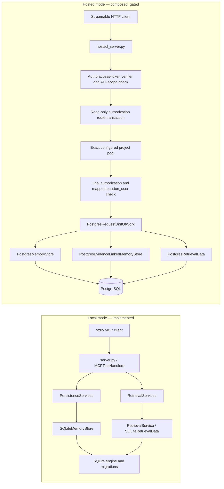

# Celestin Shared Storage Readiness

**Status: PARTIAL; hosted production readiness is BLOCKED.** This report describes source and offline-test evidence on `origin/main` commit `84b0fb89707ea59445658761ceb036c419e3c870`, inspected 2026-10-30. A schema file, adapter fake, or offline test is not evidence that PostgreSQL accepted a migration or enforced isolation on a server.

Resurrection Producer-to-Knowledge is explicitly outside this workstream. This document does not define producer, delivery, candidate-revision, conversion, or receipt behavior.

## Architecture observed

The hosted composition in `src/orbit/mcp_server/hosted_server.py`, `src/orbit/postgres/authorization.py`, and `src/orbit/postgres/unit_of_work.py` is source-level evidence only. `CELESTIN_HOSTED_PROJECT_ROLE_ISOLATION_ENABLED` defaults to false; startup readiness rejects unapproved role/lock profiles. Local `src/orbit/mcp_server/server.py` continues to build the SQLite runtime.

## Capability register

`PASS` means the stated local behavior has direct test evidence. It does not mean production readiness. `PARTIAL` means implementation exists but important behavior is unverified or not wired. `BLOCKED` means a security decision, approved environment, or live evidence is required. `NOT IMPLEMENTED` means no corresponding implementation was found.

| Capability | Status | Evidence and limits |
|---|---|---|
| Local chat and decision persistence | **PASS** | `MemoryStore` (`src/orbit/storage/protocol.py`) has message insertion, decision upsert, and status update. `SQLiteMemoryStore` delegates to existing repositories. `tests/test_mcp_persistence.py`, `tests/database/`, and MCP tool tests use temporary SQLite databases. Project labels scope rows; the local configured authorization boundary is separate from database identity. |
| Local SQLite migration/recovery | **PASS** | `src/orbit/database/engine.py` applies each numbered migration under `BEGIN IMMEDIATE`, rechecks `PRAGMA user_version`, and rolls back on errors. `tests/database/test_engine.py` exercises failure rollback and concurrent initialization. The local schema was version 2 before this task; it has messages, decisions, FTS5 tables/triggers, and indexes. |
| Local Evidence/Knowledge persistence | **NOT IMPLEMENTED at audit start** | `EvidenceLinkedMemoryStore` is defined in `src/orbit/evidence/service.py`; the service is injectable and the only production adapter found was `PostgresEvidenceLinkedMemoryStore`. No SQLite Evidence adapter or Evidence MCP tool was present. The PostgreSQL schema has the manual Evidence domain, but this is not local persistence. |
| PostgreSQL messages and decisions | **PARTIAL** | `PostgresMemoryStore` implements the current `MemoryStore` operations and has a request-bound constructor. `tests/storage/test_postgres_memory_store.py` uses a scripted connection, not PostgreSQL. Hosted UoW composition binds it to the authorized transaction. Driver, DDL, constraints, and commit behavior are not live-verified. |
| PostgreSQL Evidence/Knowledge | **PARTIAL** | Migration 0005 and `PostgresEvidenceLinkedMemoryStore` represent create/read, evidence attachment, verification, and supersession. The adapter borrows the request connection and uses nested transaction contexts for atomic multi-row operations. `tests/evidence/test_postgres_store.py` is scripted/offline; the live suite is opt-in and was not run. Hosted MCP handlers do not expose the Evidence service. |
| Retrieval and indexes | **PARTIAL** | `RetrievalData` has SQLite and PostgreSQL implementations. SQLite FTS5 and local optional semantic/document indexes are used through `RetrievalServices`. Hosted request UoW binds PostgreSQL lexical retrieval. `tests/retrieval/` and fake PostgreSQL adapter tests pass offline. PostgreSQL query/index plans and runtime performance have not been verified live; hosted semantic/PageIndex are not enabled. |
| Workspace/project authorization model | **PARTIAL** | Migrations 0001/0002/0004 define users, workspaces, projects, memberships, service grants, lifecycle and capability columns. `PostgresHostedAuthorizationSession` resolves issuer/subject identities and scoped grants; `PostgresAccessProvisioner` and `ProjectDatabaseLoginRegistry` provide code-level admin helpers. Offline tests use scripted sessions. An audited operator lifecycle, administrator UI/API, backups, and production provisioning are absent. |
| PostgreSQL tenant isolation | **BLOCKED** | Migrations 0007–0009 define and replace RLS/role/lock policies. Migrations 0008/0009 remain incompatible with the current reviewed request-readiness profile; the lock decision keeps readiness closed. No migration was applied and no live cross-project test ran. Application checks and RLS source text alone do not prove database isolation. |
| PostgreSQL migration execution | **PARTIAL** | The explicit `celestin-migrate` runner checks ordered versions and checksums, refuses adoption of unknown objects, serializes migration application, and commits each migration with its ledger row. `tests/postgres/test_migration_runner.py` uses a fake connection. PostgreSQL SQL validity, server lock behavior, role ownership and upgrade recovery remain unverified. Existing migrations are treated as immutable. |
| Project/workspace CRUD and retention | **PARTIAL / BLOCKED** | PostgreSQL schema has project/workspace lifecycle and `purge_after` metadata; authorization provisioning has scoped operations. No general cross-backend repository covers lifecycle CRUD, archive, retention eligibility, or purge. Adding delete/purge behavior requires an approved retention and ownership policy; restrictive foreign keys are not a retention service. |
| Cross-backend storage contract | **PARTIAL** | Three separate ports exist: `MemoryStore`, `EvidenceLinkedMemoryStore`, and `RetrievalData`. They do not yet define generic workspace/membership/source/archive operations. SQLite and PostgreSQL adapters have separate fake/SQLite tests, not one live-equivalent conformance run. |
| Pools, operations and recovery | **PARTIAL** | Hosted source bounds pools/timeouts, resets sessions, sanitizes failures, and exposes health checks. Offline tests inspect these code paths. Pool exhaustion, cancellation, failover, monitoring, restore, backup, and production incident behavior have not been exercised. |

## Schema and migration review

The packaged PostgreSQL migrations are numbered 0001–0009 and are applied only by the explicit runner. Migration 0001 defines authorization entities plus `chat_messages` and `project_memory`; 0002 adds user status; 0003 adds partial search indexes; 0004 adds default-deny capabilities; 0005 adds manual knowledge/evidence; 0006 adds producer/candidate/revision/review/occurrence/conversion schema groundwork; 0007 adds GUC-based RLS; 0008 replaces those policies with protected `session_user`-mapped project roles; and 0009 narrows project request-lock scope. These are source facts, not approval to use candidate/delivery semantics or evidence that any schema exists in a database.

Observed integrity measures include `(workspace_id, project_id)` references to workspace-owned projects, composite same-project references for source messages and knowledge supersession, checks for enum/status values, and project/workspace indexes. Evidence rows are ordered per knowledge record. Candidate migration 0006 constrains producer-qualified candidate and revision keys and ordered occurrence rows, but there is no producer adapter in this storage task. The separate `docs/hosted-tenancy-schema.sql` is a draft and is not executed by the packaged runner.

The migration runner has no automatic downgrade. After any schema change is applied, recovery must use a separately reviewed forward fix or approved restore. No migration was run during this task.

## Security and operational boundary

- Local SQLite remains the source of truth for stdio. Configuring a PostgreSQL DSN does not select or enable hosted transport.
- Hosted mode is a separate HTTPS composition. Token verification, API scope, explicit workspace selection, route authorization, exact project-pool selection, final authorization, and request UoW are present in source.
- The request UoW binds memory, evidence, and retrieval adapters to one connection. Repositories borrow that connection and do not finalize the outer hosted transaction.
- Project logins are mapped to a protected workspace/project scope using `session_user`; migrations 0008/0009 and hosted readiness checks encode these expectations.
- Hosted startup still fails closed. The advisory-lock function ACL/wrapper design and provider/ownership capabilities remain unresolved. Do not enable hosted serving or loosen readiness to make offline tests pass.
- Test fixture names and `CELESTIN_TEST_POSTGRES_DISPOSABLE=true` are not proof of operator approval. The live fixture expects a fresh loopback target and distinct least-privileged roles, applies migrations once, and never drops/truncates. No test target was configured here, and `psycopg` was absent.
- Auth0 tenant behavior, database roles, grants, RLS, migration execution, Neon capabilities, restore, and external monitoring were not exercised.

## Performance, retention, backup and recovery

SQLite FTS5 and PostgreSQL text-search expression indexes are defined, but no comparative query plan or load benchmark was run. Semantic vectors and PageIndex are local optional features; their hosted persistence, rebuild, and tenant lifecycle are not implemented. There is no verified pool-load, connection-loss, or failover test.

Archive timestamps/statuses and purge-eligibility timestamps exist in portions of the schema. A consistent archival API, retention schedule, purge worker, backup policy, restore objective, and restore drill are not present in the verified implementation. These require storage/product/operations decisions before destructive lifecycle behavior is added.

## Verification at audit start

- Branch `codex/celestin-shared-storage-platform` was created from locally verified `origin/main` at `84b0fb89707ea59445658761ceb036c419e3c870`; the root worktree was clean. The older feature branch's two documentation-only commits remain on that branch.
- Offline baseline command: `python -B -m pytest -p no:cacheprovider -o addopts='' tests/storage tests/database tests/evidence/test_service.py tests/evidence/test_postgres_store.py tests/retrieval tests/project_state tests/postgres/test_migration_runner.py tests/postgres/test_migrate_cli.py tests/postgres/test_live_support.py tests/postgres/test_request_unit_of_work.py tests/postgres/test_hosted_authorization.py tests/postgres/test_hosted_identity_boundary.py tests/postgres/test_provisioning.py tests/test_hosted_auth.py tests/test_hosted_server.py tests/test_hosted_scope.py tests/test_mcp_authorization.py tests/test_mcp_persistence.py tests/test_mcp_tools.py tests/test_mcp_protocol.py` — **1,044 passed, 4 failed, 6 skipped**. Failures: Windows symlink privilege in two project-state tests; Windows-path JSON escaping in one resolver test; and an Auth0 `nbf` boundary test accepted a token at the exact leeway boundary.
- Storage-focused subset (same command without `tests/project_state` and `tests/test_hosted_auth.py`): **974 passed, 6 skipped**.
- `rfc8785` and `psycopg` are unavailable in the active Python 3.13.9 environment. No dependencies were installed. Live PostgreSQL tests, databases, SQL operations, migrations, external services, and deployments were not run.

## Remaining blockers and next work

Safe next implementation: add the existing `EvidenceLinkedMemoryStore` contract to local SQLite through an additive SQLite migration and adapter, without adding producer identity, conversion, new MCP tools, or hosted privileges. Run the reusable store contract against real temporary SQLite files and verify upgrade preservation from schema version 2. This is independent of PostgreSQL ACL and producer decisions.

The following remain blocked or intentionally absent: live PostgreSQL syntax/constraint and transaction evidence; hosted RLS/isolation approval and live test; Neon advisory-lock/ownership capability evidence; production provisioning and admin lifecycle; shared retention, archive, purge, backup and restore policy; hosted retrieval performance; and complete cross-backend CRUD interfaces for projects, workspaces, memberships, sources, indexing and retention. Do not add guessed delete, purge, approval, or retry semantics.

## Progress updates

Updates below record bounded implementations and the checks actually run. They do not replace the source audit above or turn fake/live-skipped results into production evidence.
